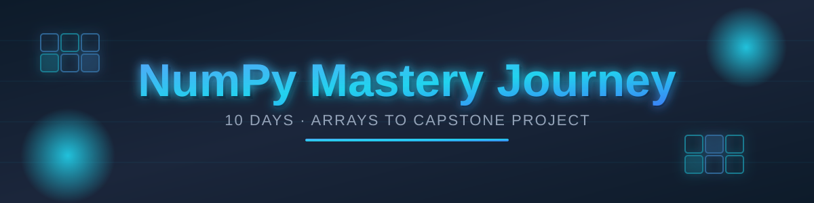

<!-- ========== ANIMATED HEADER (gradient background wave) ========== -->
<div align="center">




<!-- Typing animation -->


<br/>


</div>

A structured 10-day practice journey to build strong, practical NumPy fundamentals — from basic array creation to a full capstone project. Every day includes hands-on problems, real explanations of the "why" behind each concept, and a dedicated README documenting what was learned.


## 🎯 Goal

Go from zero to confidently using NumPy for data manipulation, numerical computing, and array-based problem solving — without loops, using vectorized thinking.


## 🗂️ Repository Structure

```
numpy-mastery-journey/
├── Day1_practice/          # Array creation & indexing
├── Day2_practice/          # Slicing, boolean & fancy indexing
├── Day3_practice/          # Broadcasting
├── Day4_practice/          # Axis operations
├── Day5_practice/          # Reshaping & stacking
├── Day6_practice/          # Statistics & sorting/searching
├── Day7_practice/          # Linear algebra + copy vs view
├── Day8_practice/          # Real-world problem: Sales Data Analysis
├── Day9_practice/          # Real-world problem: Weather Data Analysis
├── Day10_practice/         # Capstone project: E-Commerce Order Analyzer
├── student-analyzer-project/  # Mini project combining Day 1-4 concepts
└── README.md                # This file
```

---

## 📅 Day-by-Day Breakdown

### Day 1 — Array Creation & Basic Indexing
The foundation. Every NumPy operation starts with knowing how to build and inspect arrays.
- Creating 1D and 2D arrays with `np.array()`
- Pre-filled arrays: `np.zeros()`, `np.ones()`, `np.full()`
- Sequences: `np.arange()` (step-based) vs `np.linspace()` (count-based)
- Array attributes: `.shape`, `.ndim`, `.size`, `.dtype`
- Special matrices: `np.eye()` (identity), `np.random.randint()` (random)
- Challenge: building a pattern (chessboard) using pure indexing, no loops

### Day 2 — Slicing, Boolean & Fancy Indexing
How to pull exactly the data you need out of an array.
- Slicing 1D and 2D arrays (`arr[start:stop:step]`)
- Boolean indexing — filtering elements using a condition (`arr[arr > 50]`)
- Fancy indexing — selecting multiple specific indices at once (`arr[[1,3,5]]`)
- Boolean masking to conditionally replace values (`arr[arr < 0] = 0`)
- Combining multiple conditions with `&` (not Python's `and`)

### Day 3 — Broadcasting
The concept that makes vectorized NumPy code possible.
- Broadcasting rule: compare shapes right-to-left — dimensions must be equal or one must be 1
- Scalar broadcasting, 1D-to-2D broadcasting, and outer broadcasting (column + row vector)
- `keepdims=True` — why reduction results need it before being combined back with the original array
- Practical use: row/column normalization, mean subtraction (standardization)

### Day 4 — Axis Operations
Understanding the difference between operating "down" vs "across" an array.
- `axis=0` (through columns, collapses rows) vs `axis=1` (through rows, collapses columns)
- `sum`, `mean`, `max`, `min` along an axis
- `argmax` / `argmin` — finding the *index* of the extreme value, not just the value
- Common mistake: using `len()` instead of `.shape[i]` when computing averages

### Day 5 — Reshaping & Stacking
Changing the shape of data without changing its content, and combining arrays.
- `reshape()` — changing dimensions while keeping total element count the same
- `flatten()` vs `ravel()` — converting to 1D (copy vs view difference)
- `transpose()` / `.T` — flipping rows and columns
- Combining arrays: `np.vstack()`, `np.hstack()`, `np.concatenate()`
- Splitting arrays: `np.split()`, `np.array_split()`

### Day 6 — Statistics, Sorting & Searching
Extracting insights and organizing array data.
- Statistical functions: `np.std()` (spread/variation), `np.var()`, `np.median()`, `np.cumsum()`
- Sorting: `np.sort()` (sorted values) vs `np.argsort()` (indices that would sort the array)
- Searching: `np.where()` for conditional lookups, `np.unique()` for distinct values

### Day 7 — Linear Algebra Basics + Copy vs View
Matrix math fundamentals and a critical memory-safety concept.
- Element-wise multiplication (`*`) vs matrix multiplication (`np.dot()` / `@` / `np.matmul()`)
- Matrix transpose and its effect on multiplication
- `np.linalg.det()` — determinant, `np.linalg.inv()` — inverse, and verifying `matrix @ inverse ≈ identity`
- **Copy vs View:** slicing creates a *view* (shares memory with the original — modifying it changes the original too); `.copy()` creates an independent array

### Day 8 — Real-World Problem: Sales Data Analysis
Applying every concept so far to a retail sales dataset (30 days × 5 products).
- Per-product and per-day totals using axis operations
- Best/worst performers using `argmax` / `argmin`
- Filtering high-sales days with boolean masking
- Reshaping daily data into weekly blocks
- Normalizing sales values and calculating revenue via broadcasting (`sales × prices`)

### Day 9 — Real-World Problem: Weather Data Analysis
A second real dataset (temperature across 4 cities, 12 months) to reinforce the same skills in a new context.
- Yearly and monthly averages using axis operations
- Hottest/coldest month per city using `argmax` / `argmin`
- Variability across cities using `np.std()`
- Filtering extreme temperatures with boolean masking
- Ranking cities by average temperature using `np.argsort()`
- Calculating temperature anomalies (deviation from a city's own average) via broadcasting

### Day 10 — Capstone Project: E-Commerce Order Analyzer
The final project — every concept from Day 1 to Day 9 combined into one complete analysis.
- Revenue calculation via broadcasting (`orders × prices`)
- Best-seller (by units) vs most profitable (by revenue) — two different metrics
- Weekly revenue breakdown via reshaping
- Ranking products by revenue using `argsort`
- Normalizing daily revenue and detecting high-sales days via boolean masking
- Measuring sales consistency per product using `np.std()`
- A final consolidated summary report printed from all the above results

---

## 🧠 Core Concepts Mastered

| Concept | Why It Matters |
|---|---|
| Vectorization | Replacing loops with array operations — faster and more "NumPy-native" |
| Broadcasting | Letting arrays of different shapes work together automatically |
| Axis operations | Controlling whether calculations run row-wise or column-wise |
| Boolean masking | Filtering and conditionally modifying data without loops |
| Reshaping | Restructuring data to match the shape an operation or model needs |
| Copy vs View | Avoiding silent bugs caused by unintentionally modifying original data |

## 🛠️ Featured Project

**[Student Performance Analyzer](./student-analyzer-project)** — a mini project built after Day 4, applying array creation, axis operations, boolean masking, and conditional logic (`np.where`) to analyze student marks data.

---

<div align="center">

### ✨ Made by **Sudhanshu Dhande** ✨
[](https://github.com/sudhanshudhande19)

<!-- ========== FOOTER WAVE (gradient background) ========== -->


</div>